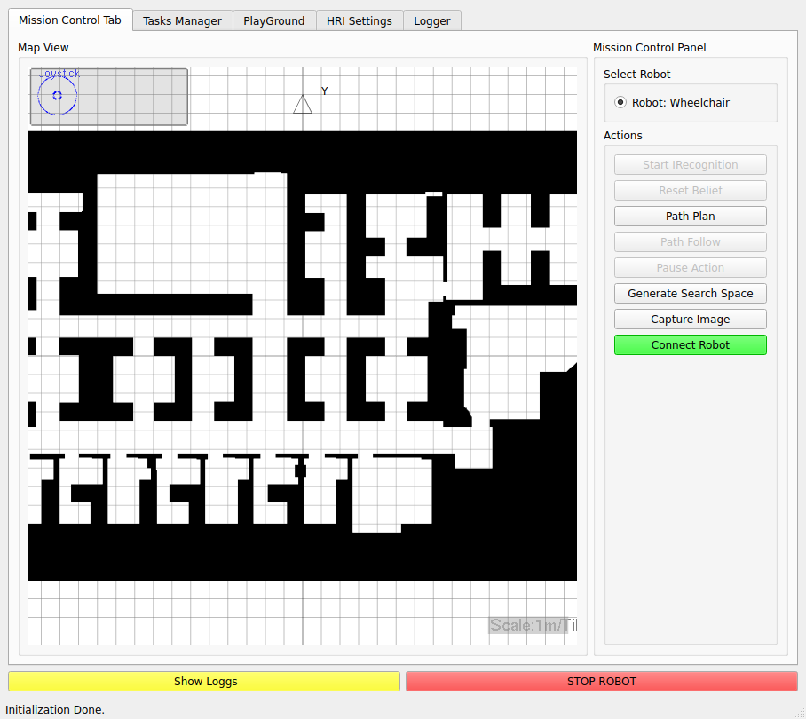
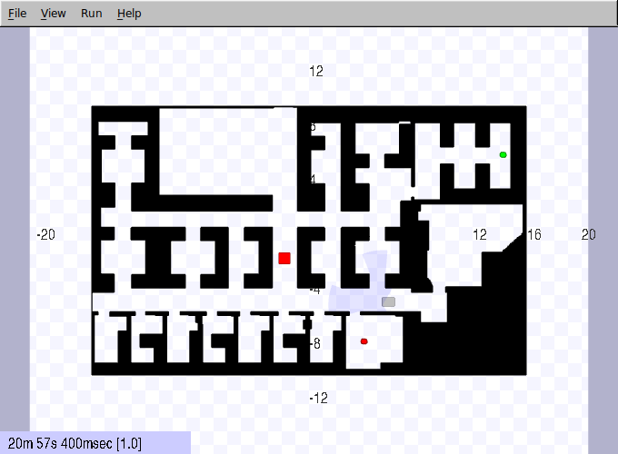
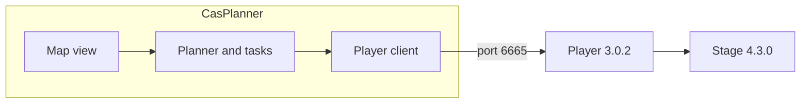

# CasPlanner

CasPlanner is a desktop client for planning and supervising mobile robots. It draws the map, talks to a [Player](https://playerproject.github.io/) server, and can drive a real robot or a [Stage](https://github.com/rtv/Stage) simulation through the same interface.

It was written by Tarek Taha and Jaime Valls Miro at the University of Technology Sydney (UTS-CAS). This tree is CasPlanner 1.0, brought up to date so it builds with Qt 5 and runs from Docker. The original project page is [cas-robotics.sourceforge.net](http://cas-robotics.sourceforge.net).

## The two windows

`docker compose up` opens the planner and the simulator side by side.

The mission-control window is the map, the robot selector, and the action buttons. The mouse wheel zooms the map. `[` and `]` zoom as well.



Stage shows the same floor, the wheelchair (red), and the other simulated bodies. The clock in the corner advances while the simulation is running. Press `p` in that window to pause.



## What you can do with it

- Build and serve an occupancy map. Map construction uses MRICP (Map Reference Iterative Closest Point).
- Localize and avoid obstacles with Player drivers. The sample world uses AMCL for localization and the ND driver, exposed as `position2d:1`, for vector-field-histogram avoidance.
- Follow waypoints with CSTEP.
- Plan and replan with a sampled A\* search: a regular grid plus bridge samples through narrow passages.
- Assign tasks, record navigation, and play those recordings back.
- Run a wheelchair-specific POMDP for destination belief. That model is particular to this application.

The platform was built for the UTS wheelchair work. The same GUI can be pointed at another Player robot by editing the configuration file.

## Run it

You need Docker with Compose, and a display the containers can draw on (X11 or XWayland). Once per login, allow local root clients to use that display, then build and start both processes:

```bash
xhost +local:root
docker compose up --build
```

The first build compiles Player 3.0.2 and Stage 4.3.0 from source inside the image, then CasPlanner. Later starts reuse `casplanner:local`.

| Window | Process | Role |
| --- | --- | --- |
| CAS Navigation System | `casplanner` | Qt interface, loaded with `wheelchair.cfg` |
| cas.world | `stage` | Player server plus the Stage plugin, loaded with `StageSim/casarea.cfg` |

`wheelchair.cfg` sets `startConnected` to 0, so the GUI comes up on its own. Click **Connect Robot**. The client uses `127.0.0.1:6665`. Stage also listens on 6666 and 6667 for the other simulated robots.

`Failed to query drm device` and `failed to load driver: iris` are the software OpenGL fallback inside the container. Both windows still open.

Stop the stack with Ctrl-C, or `docker compose down` if it is running in the background.

## How the pieces connect



CasPlanner never loads Player drivers itself. It is a client. Player publishes position, laser, map, and localization devices. Stage simulates those devices from `StageSim/cas.world`. Stage 4 models a range scanner as a `ranger`. `casarea.cfg` inserts Player's `rangertolaser` driver so the existing laser interface in CasPlanner stays the same.

| Path | What lives there |
| --- | --- |
| `gui/` | Main window, mission control, and the other tabs |
| `modules/CommManager/` | Player connection and device subscriptions |
| `modules/PathPlanner/` | Search space, A\*, Voronoi and social planners |
| `modules/Navigator/` | Path following |
| `modules/MapManager/` | Occupancy grid |
| `modules/Rendering/` | OpenGL map view |
| `modules/TasksManager/` | Task list and playback |
| `modules/HumanRobotInteraction/` | Intention recognition and the wheelchair POMDP |
| `StageSim/` | World file, robot models, and the Player config |
| `docker/` | Source build of Player and Stage |

## Configuration

The only file you normally edit is the one passed on the command line. `wheelchair.cfg` is the sample. Sections:

| Section | Purpose |
| --- | --- |
| `GUI` | How the map is drawn |
| `Robot` | Address, shape, and which Player devices to open |
| `Planner` | Sampling used to build the search space |
| `Map` | Occupancy image and its resolution |
| `Navigator` | Path following and obstacle avoidance |
| `ForceField` | Older avoidance method. Leave it unused. |

The mission-control tab can edit some of these values. Saving a full configuration from the GUI is still experimental. Pass the file on the command line.

### GUI

| Parameter | Default | Meaning |
| --- | --- | --- |
| `renderingMethod` | `"OpenGL"` | Renderer. The supported value is OpenGL. |
| `renderingPeriod` | `100` | Redraw period, in milliseconds. |

### Robot

One `Robot` block is one robot. Repeat the block for another Player port.

| Parameter | Default | Meaning |
| --- | --- | --- |
| `robotName` | `"RobotX"` | Name shown in the robot list. |
| `robotIp` | `"127.0.0.1"` | Player host. |
| `robotPort` | `6665` | Player port. |
| `robotLength` | `1.2` | Longer body dimension, in metres. |
| `robotWidth` | `0.65` | Shorter body dimension, in metres. |
| `robotCenter` | `[-0.3 0]` | Rotation centre relative to the geometric centre. |
| `robotModel` | `"diff"` | Motion model. |
| `robotMass` | `50` | Mass, in kilograms. |
| `robotMI` | `10` | Moment of inertia. |
| `activateControl` | `0` | `1` sends drive commands. `0` only monitors. |
| `startConnected` | `0` in `wheelchair.cfg` | `1` connects as soon as the window opens. |
| `lasers` | `[0]` | Laser device indexes. |
| `position` | `[0]` | Position device index used for drive. |
| `ptz` | `[0]` | Pan-tilt index, when a PTZ is present. |
| `map` | `[0]` | Map device index. |
| `localizer` | `[0]` | Localization device index. AMCL in the sample. |
| `vfh` | `[1]` | Obstacle-avoidance position device. ND on index 1 in the sample. |

### Planner

These numbers control the sampled search space used by the modified A\*.

| Parameter | Default | Meaning |
| --- | --- | --- |
| `bridge_len` | `1.8` | Length of the bridge test, in metres. |
| `bridge_res` | `0.1` | Step along a bridge sample. |
| `reg_grid` | `0.2` | Spacing of the regular grid. |
| `obst_exp` | `0.2` | How far obstacles are grown before collision checks. |
| `conn_rad` | `0.5` | Radius for connecting neighbouring samples. |
| `obst_pen` | `3` | Extra cost for paths that pass close to obstacles. |
| `dist_goal` | `0.3` | Distance at which a sample counts as the goal. |

### Map

| Parameter | Default | Meaning |
| --- | --- | --- |
| `source` | `"static-map"` | Where the grid comes from. |
| `mapname` | empty | Path of the map image, relative to the working directory. |
| `pixel_res` | `0.05` | Metres per pixel. |
| `negate` | `0` | `1` swaps the meaning of dark and light pixels. |

The sample map is `resources/casarea_sub.png`.

### Navigator

| Parameter | Default | Meaning |
| --- | --- | --- |
| `k_dist` | `0` | Distance gain for the path follower. |
| `k_theta` | `4.5` | Heading gain for the path follower. |
| `safety_dist` | `0.5` | Closest approach to an obstacle, in metres. |
| `obst_avoid` | `"VFH"` | `"VFH"` or `"NO_AVOID"`. |
| `traversable_dist` | `3` | Spacing of waypoints along the path. |
| `local_dist` | `2` | Lookahead used while tracking. |
| `reg_grid` | `0.3` | Local sampling resolution. |
| `obst_exp` | `0.2` | Local obstacle growth. |
| `conn_rad` | `0.7` | Local sample connection radius. |
| `obst_pen` | `3` | Local clearance penalty. |
| `dist_goal` | `0.4` | Distance that counts as arriving. |
| `laser_pose` | `[0 0 0]` | Laser pose on the robot: x, y, yaw. |
| `linear_velocity` | `0.03` | Speed cap, in metres per second. |

`obst_avoid "FORCE_FIELD"` is the old force-field controller. Use `VFH`.

## Build on the host

The Docker image is the supported build. A native build needs the same libraries, plus a Player tree installed from source. `PLAYER_ROOT` must contain `include/player-3.0/playerconfig.h`.

```bash
cmake -S . -B build -DPLAYER_ROOT=/usr/local
cmake --build build
./CasPlanner wheelchair.cfg
```

The binary is written in the project root. Start Player yourself, from `StageSim`, before connecting:

```bash
cd StageSim
player casarea.cfg
```

## License

Source files are released under the GNU General Public License, version 2. See [COPYING](COPYING).
